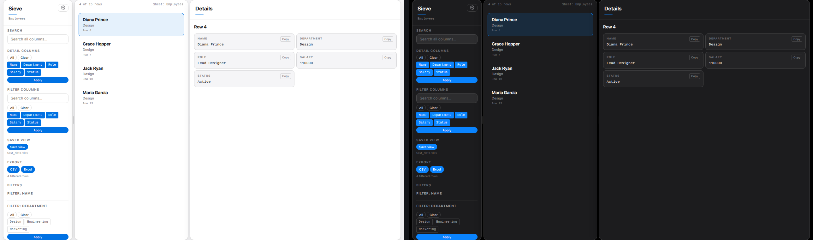

# Sieve

Spreadsheet viewing without opening Excel. Upload a file, narrow it down with
search and filters, look at the rows you care about, and export just those
rows as CSV or Excel. One Python file, FastHTML + HTMX + pandas.



## What it does

- Upload `.xlsx`, `.xls`, or `.csv` — browse every sheet
- Search across the whole sheet, filter columns with checkboxes or text
- Pick which columns show in the detail pane
- Save a view per file and sheet; it comes back when you open the file again
- Export the filtered rows as CSV or Excel
- Four themes — Ink, Paper, Frost, Midnight — remembered in your browser

## Run it

```bash
conda create -n fhtml python=3.11 -y
conda activate fhtml
pip install -r requirements.txt
python app.py
```

Then open http://localhost:8765.

## Good to know

- Single process, in-memory state — run it with one worker.
- Nothing leaves your machine; saved views live in a local `saved_views.json`.
- Files up to 100 MB; the row list renders 500 cards at a time.
